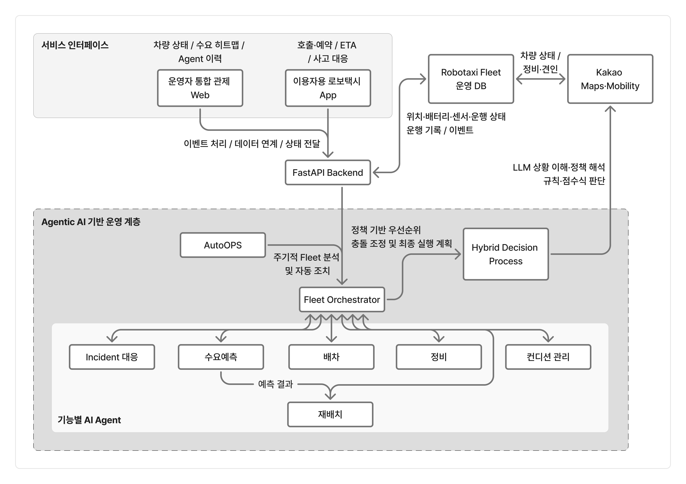
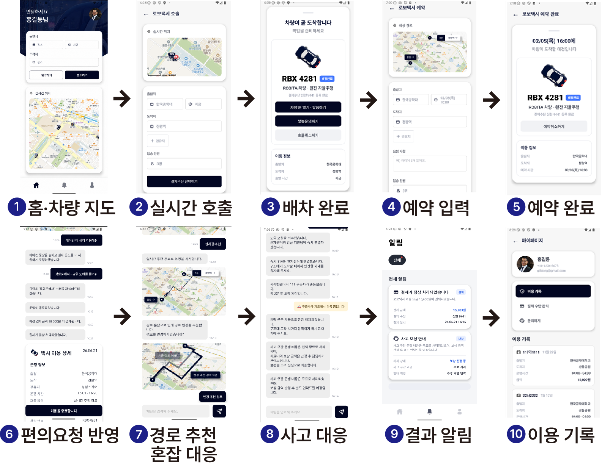
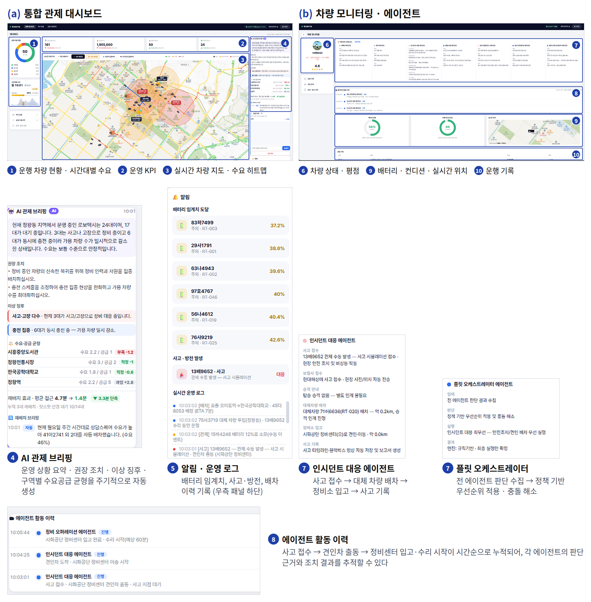

# ROBITA — Agentic AI 기반 로보택시 통합 운영·관제 플랫폼

> 2026 한이음 드림업 프로젝트
> 무인 운행 로보택시 플릿을 AI 에이전트가 자율 운영하고, 사람이 필요한 지점에서만
> 관리자가 개입하는 Human-in-the-Loop 관제 플랫폼

<!-- 제출 전 확인: 저장소 이름을 프로젝트 번호로 맞춰 주세요 (github.com/계정명/프로젝트번호) -->

---

## 💡 1. 프로젝트 개요

### 1-1. 프로젝트 소개

ROBITA는 운전석이 비어 있는 로보택시를 **운영사 입장에서 관제**하는 플랫폼입니다.

차량 배차, 사고 대응, 정비 판단, 수요 예측 재배치를 7개의 AI 에이전트가 나눠 맡고,
이들의 판단이 서로 충돌하면 **플릿 오케스트레이터**가 정책 기반 우선순위로 최종 실행안을
확정합니다. 다만 모든 판단을 AI에 맡기지 않고, **AI가 처리할 수 없는 문의와 관리자의
직접 개입이 필요한 상황**은 사람에게 넘기는 Human-in-the-Loop 구조를 함께 둡니다.

운행 지역은 경기도 시흥시 정왕동 일대(한국공학대학교 포함)이며, 실제 차량 데이터 대신
백그라운드 시뮬레이터가 47대 차량의 위치·배터리·사고·방전을 실시간으로 생성합니다.

### 1-2. 개발 배경 및 필요성

택시에서 운전석이 사라지면 운전 기능만 사라지는 것이 아닙니다.
승객이 "저기서 세워 주세요"라고 말할 상대, 사고가 났을 때 상황을 설명해 줄 사람,
분실물을 물어볼 창구가 함께 사라집니다. **무인 운행은 승객이 사람에게 닿을 경로까지
함께 제거합니다.**

그래서 완전 무인 운행에는 두 가지 공백이 생깁니다.

**(1) 운영 측 공백 — 차량이 스스로 판단해야 하는 범위가 넓어진다**
배차, 충전 시점, 정비 전환, 사고 후속 조치를 사람이 일일이 지시할 수 없습니다.
차량 수가 늘수록 관제 인력이 선형으로 늘어나야 하는 구조는 지속 가능하지 않습니다.

**(2) 승객 측 공백 — 차 안에 물어볼 사람이 없다**
AI 응대가 닿지 않는 요청이 반드시 남습니다. 이때 연결할 곳이 없으면 승객은
불안해하고, 이는 서비스 신뢰도로 직결됩니다.

ROBITA는 (1)을 에이전트 자율 운영으로, (2)를 관리자 개입 경로 확보로 풀었습니다.

### 1-3. 프로젝트 특장점

| 특장점 | 내용 |
|---|---|
| **에이전트 간 충돌 해소** | 7개 에이전트의 판단이 엇갈릴 때 정책 기반 우선순위 사다리로 단일 실행안을 확정합니다. 안전 > 운행 지속 > 효율 순서가 코드에 명시돼 있습니다. |
| **Human-in-the-Loop** | AI 응대 실패 시 관리자 상담 연결, 관리자의 수동 집중 배치 등 사람이 개입할 지점을 설계에 포함했습니다. 개입 중에도 주행 제어권은 자율주행 시스템에 유지됩니다. |
| **판단 근거의 가시화** | 각 에이전트가 무엇을 입력받아 어떻게 판단하고 무엇을 실행했는지 입력→판단→실행→결과 4단계로 기록되어, 관리자가 AI의 결정을 사후 추적할 수 있습니다. |
| **LLM 없이도 동작** | API 키가 없으면 동일한 데이터로 규칙 기반 폴백이 작동합니다. 시연 환경이나 네트워크 제약에서도 기능이 멈추지 않습니다. |
| **실제 도로 기반 시뮬레이션** | 카카오모빌리티 길찾기로 받은 실제 도로 경로를 따라 차량이 주행합니다. 직선 이동이나 건물 관통이 없습니다. |

### 1-4. 주요 기능

**관제 대시보드** (`/dashboard`)
- 운행 차량 현황 도넛, 24시간 수요 곡선, 운영 KPI(운행 건수·수익·차량 수)
- 카카오맵 실시간 차량 마커 — 배터리 상태별 색상, 수요 히트맵, 도로 혼잡도
- **AI 관제 브리핑** — 상황 요약·권장 조치·이상 징후·구역별 수급 균형을 18초마다 자동 생성
- 알림 패널(배터리 임계치·사고·방전), 고객 상담 요청 수신

**차량 모니터링** (`/monitor/{id}`)
- 7개 에이전트 진행 로그(입력→판단→실행→결과)
- 에이전트 활동 이력 타임라인(사고 접수 → 견인 출동 → 정비소 입고 → 수리)
- 배터리·컨디션 게이지, 실시간 위치, 운행 기록

**고객 앱** (`/rider`)
- 챗봇 호출, 요금·ETA 안내, 실시간 차량 추적, 경로 선택
- 탑승 중 요청(에어컨·음악·경유지·인원 변경)을 AI 에이전트가 처리
- 사고 시 부상 확인 및 대체 차량 재배차, 분실물 접수
- **AI가 해결하지 못하면 관리자 상담사로 연결**

**관제 콘솔 / 데모 제어** (`/console`, `/control`)
- 시간 이동·배속·요일 지정으로 수요 상황 재현
- 사고·고장·방전 이벤트 발생
- 특정 지점 집중 배치(관리자 수동 개입)

### 1-5. 기대 효과 및 활용 분야

- **관제 인력 대비 운영 차량 수 확대** — 정상 운행은 에이전트가 처리하고 사람은 예외만 봅니다.
- **공차 주행 감소** — 수요 예측 기반 사전 재배치로 핫스팟 평균 접근 거리를 단축합니다.
- **사고 대응 시간 단축** — 접수·보험·대체 배차·견인이 하나의 절차로 연계됩니다.
- **승객 신뢰 확보** — AI 응대 실패 시에도 사람에게 닿는 경로가 보장됩니다.
- **활용 분야** — 로보택시 운영사 관제 시스템, 자율주행 셔틀, 물류 플릿 관리,
  차량 공유 서비스의 재배치 최적화

### 1-6. 기술 스택

| 구분 | 기술 |
|---|---|
| Backend | Python 3.9+, FastAPI, Uvicorn, WebSocket |
| Frontend | HTML / CSS / Vanilla JavaScript, Jinja2 |
| AI / LLM | OpenAI GPT, Google Gemini (키 미설정 시 규칙 기반 폴백) |
| 지도 / 경로 | 카카오맵 JavaScript API, 카카오모빌리티 Directions API |
| Database | SQLite (계정·세션) |
| 인증 | 세션 쿠키, pbkdf2 비밀번호 해싱 |

---


<h2>💡 2. 팀원 소개</h2>

<table>
  <tr>
    <td align="center" width="20%">
      
    </td>
    <td align="center" width="20%">
      
    </td>
    <td align="center" width="20%">
      
    </td>
    <td align="center" width="20%">
      
    </td>
    <td align="center" width="20%">
      
    </td>
  </tr>
  <tr>
    <th align="center">멘티 · 팀장</th>
    <th align="center">멘티 · 팀원</th>
    <th align="center">멘티 · 팀원</th>
    <th align="center">멘티 · 팀원</th>
    <th align="center">멘토</th>
  </tr>
  <tr>
    <td align="center">
      · 프로젝트 기획, 총괄<br>
      · 개발 일정 관리
    </td>
    <td align="center">
      · UI/UX 기획<br>
      · 프론트엔드 개발
    </td>
    <td align="center">
  · AI&nbsp;에이전트&nbsp;개발<br>
  · 데이터 분석
</td>
    </td>
    <td align="center">
      · 백엔드 개발<br>
      · 시스템 통합
    </td>
    <td align="center">
      · 기술 자문<br>
      · 개발 방향 검토
    </td>
  </tr>
</table>


---

## 💡 3. 시스템 구성도

### · 시스템 구성도


### · 사용자용 App 흐름도


### · 관리자용 Web 흐름도


### 소프트웨어 구성

```
                   ┌───────────────────────────┐
   관리자 ────────▶│   관제 대시보드 (웹)       │
                   │   차량 모니터링            │
                   └─────────────┬─────────────┘
                                 │ WebSocket (2초 주기)
                   ┌─────────────▼─────────────┐
   승객  ─────────▶│      FastAPI 서버          │
   (모바일 앱)     │                            │
                   │  ┌──────────────────────┐  │
                   │  │  AI 에이전트 7종      │  │
                   │  │  배차 / 재배치 /      │  │
                   │  │  인시던트 / 관제 /    │  │
                   │  │  정비 인텔리전스 /    │  │
                   │  │  정비 오퍼레이션 /    │  │
                   │  │  플릿 오케스트레이터  │  │
                   │  └──────────┬───────────┘  │
                   │             │               │
                   │  ┌──────────▼───────────┐  │
                   │  │  자율 관제 엔진       │  │
                   │  │  (AutoOps, 18초 주기) │  │
                   │  └──────────────────────┘  │
                   │                            │
                   │  ┌──────────────────────┐  │
                   │  │  플릿 시뮬레이터      │  │
                   │  │  차량 47대 상태 생성  │  │
                   │  └──────────────────────┘  │
                   └──────┬──────────────┬──────┘
                          │              │
               ┌──────────▼───┐  ┌───────▼────────┐
               │ OpenAI /     │  │ 카카오맵 /     │
               │ Gemini API   │  │ 카카오모빌리티 │
               └──────────────┘  └────────────────┘
```

### 에이전트 판단 흐름

```
  차량 상태 변화
       │
       ├─▶ 재배치 에이전트 ──────┐
       ├─▶ 배차 에이전트 ────────┤
       ├─▶ 인시던트 대응 ────────┤
       ├─▶ 통합 관제 ────────────┼──▶ 플릿 오케스트레이터 ──▶ 최종 실행안
       ├─▶ 정비 인텔리전스 ──────┤         (우선순위 적용)
       └─▶ 정비 오퍼레이션 ──────┘                │
                                                  │
                                      AI 처리 불가 │
                                                  ▼
                                          관리자 개입 (HITL)
```

---


## 💡 4. 작품 소개영상

[](https://youtu.be/ZF9aHI42Zic)


---

## 💡 5. 핵심 소스코드

### 5-1. 플릿 오케스트레이터 — 에이전트 판단 충돌 해소

소스코드 설명 : 7개 에이전트의 판단이 서로 다른 조치를 가리킬 때, 어느 것을 먼저
실행할지 결정하는 부분입니다. 배터리가 부족해도 승객이 타고 있으면 운행을 유지하고,
사고가 났다면 다른 모든 판단보다 안전 조치를 앞세웁니다. 안전 → 운행 지속 → 효율
순서가 조건문 순서로 그대로 표현되어 있습니다. (`app/main.py`)

```python
# 7) 플릿 오케스트레이터 에이전트
if v.incident:
    priority = "인시던트 대응 최우선 — 안전조치/견인 배차 우선 실행"
elif risk_res["immediate_action"]:
    priority = "정비 전환 우선 — 운행 제한 후 정비 오퍼레이션 실행"
elif v.battery_state in ("DANGER", "CAUTION") and v.status != STATUS_CHARGING:
    priority = "충전 우선 — 인근 차고지 재배치 권고"
elif v.passenger:
    priority = "현재 배차 유지 — 경로 모델 ETA 기준 정상 진행"
else:
    priority = "수요 예측 기반 재배치 권고 — 공차 최소화"

logs.append({
    "key": "orchestrator",
    "name": "플릿 오케스트레이터 에이전트",
    "state": "active",
    "steps": [
        step("입력", "전 에이전트 판단 결과 수집"),
        step("판단", "정책 기반 우선순위 적용 및 충돌 해소"),
        step("실행", priority),
        step("결과", f"엔진: {llmsvc.engine_label(risk_res['engine'])} · 최종 실행안 확정"),
    ],
})
```

### 5-2. 자율 관제 엔진 — 자동 실행과 관리자 권고의 분리

소스코드 설명 : 18초마다 전체 운영 상황을 분석하는 메서드입니다. 주목할 점은
**자동으로 실행한 조치(`actions`)와 관리자에게 넘기는 권고(`recommendations`)를
분리해 반환**한다는 것입니다. 시스템이 스스로 처리한 것과 사람의 판단이 필요한 것을
구분하는 지점이며, Human-in-the-Loop 구조가 코드로 드러나는 부분입니다.
LLM 호출이 실패하면 같은 지표로 규칙 기반 요약을 생성해 기능이 멈추지 않습니다.
(`app/ops.py`)

```python
def run(self) -> dict:
    m = self.zone_metrics()
    clock = fleet.clock_state()
    demand = clock.get("demand", 0.0)

    anomalies = self.detect_anomalies(m, demand)   # 이상 징후 감지
    actions = self.rebalance(m)                    # 사전 재배치 자동 실행

    brief = self._llm_briefing(m, clock, anomalies, actions)
    if brief is None:                              # LLM 실패 시 규칙 기반 폴백
        summary, recs = self._fallback_summary(m, clock, anomalies, actions)
        engine = "rule"
    else:
        summary, recs = brief
        engine = "ai"

    self.state = {
        "ts": clock["sim_time"],
        "summary": summary,
        "recommendations": recs,     # 관리자가 판단할 권고
        "anomalies": anomalies,
        "actions": actions,          # 시스템이 이미 실행한 조치
        "zones": [...],
        "engine": engine,
    }
    return self.state
```

### 5-3. 차량 배정 모델 — 가중 점수로 최적 차량 선택

소스코드 설명 : 호출이 들어왔을 때 어느 차량을 보낼지 결정하는 부분입니다.
도착 예정 시간·배터리·청결도를 각각 0~1로 정규화한 뒤 가중합으로 총점을 냅니다.
"가까워서 골랐다"가 아니라 **어떤 수치가 몇 점이었는지 계산식 그대로 관리자 화면에
표시**되므로, AI의 선택 근거를 사람이 검증할 수 있습니다.
(`app/llm/assignment.py`)

```python
# 배정 점수 가중치(합 = 1.0)
W_ETA, W_BATT, W_CLEAN = 0.50, 0.30, 0.20
_ETA_REF_MIN = 30.0  # ETA 정규화 기준


def _score_parts(c: dict) -> dict:
    """후보 차량의 정규화 점수(각 0~1)와 가중 총점을 계산한다."""
    eta_s = max(0.0, 1.0 - c["eta_min"] / _ETA_REF_MIN)      # ETA 낮을수록 1
    bat_s = max(0.0, min(1.0, c["battery"] / 100.0))         # 배터리 높을수록 1
    cln_s = max(0.0, min(1.0, c["cleanliness"] / 100.0))     # 청결 높을수록 1
    total = W_ETA * eta_s + W_BATT * bat_s + W_CLEAN * cln_s
    return {"eta_s": round(eta_s, 2), "bat_s": round(bat_s, 2),
            "cln_s": round(cln_s, 2), "total": round(total, 3)}


# 점수 계산식으로 최적 차량 선택
for c in cands:
    c["score_parts"] = _score_parts(c)
    c["score"] = c["score_parts"]["total"]
cands.sort(key=lambda c: c["score"], reverse=True)   # 총점 높은 순
chosen = cands[0]
```

---

## 실행 방법

```bash
pip install -r requirements.txt
cp .env.example .env     # 윈도우: Copy-Item .env.example .env
python run.py
```

브라우저에서 `http://127.0.0.1:8000` 접속

기본 관리자 계정 : `admin@robotaxi.local` / `admin1234`

`.env` 에 API 키를 넣지 않아도 실행됩니다. 키가 없으면 LLM 대신 규칙 기반으로 동작하고,
지도 키가 없으면 지도만 표시되지 않습니다.

자세한 기능 설명은 [docs/개발_상세설명.md](docs/개발_상세설명.md) 를 참고하세요.

---

## 폴더 구조

```
.
├── run.py                  실행 스크립트
├── requirements.txt        의존성
├── .env.example            환경설정 예시
├── test_logic.py           로직 검증 테스트
├── app/
│   ├── main.py             FastAPI 본체, 페이지·API·에이전트 로그
│   ├── simulation.py       플릿 시뮬레이션 엔진
│   ├── ops.py              자율 관제 엔진 (AI 관제 브리핑)
│   ├── rider.py            고객 앱 챗봇
│   ├── routing.py          카카오모빌리티 길찾기
│   ├── area.py             운행 지역 좌표·수요 데이터
│   ├── auth.py             회원가입·로그인
│   ├── support.py          상담사 연결
│   ├── config.py           환경설정
│   └── llm/
│       ├── assignment.py   차량 배정 모델
│       ├── risk.py         위험 분석 모델
│       ├── route.py        최적 경로 탐색 모델
│       ├── incident.py     사고 대응 모델
│       └── llm.py          OpenAI / Gemini 호출 분기
├── templates/              HTML 화면
├── static/                 JS · CSS · 이미지
└── docs/
    └── 개발_상세설명.md
```
